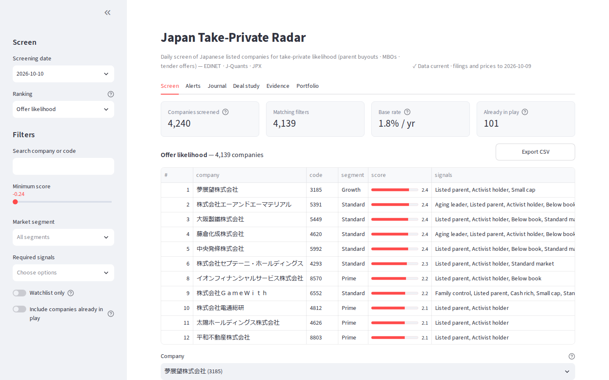
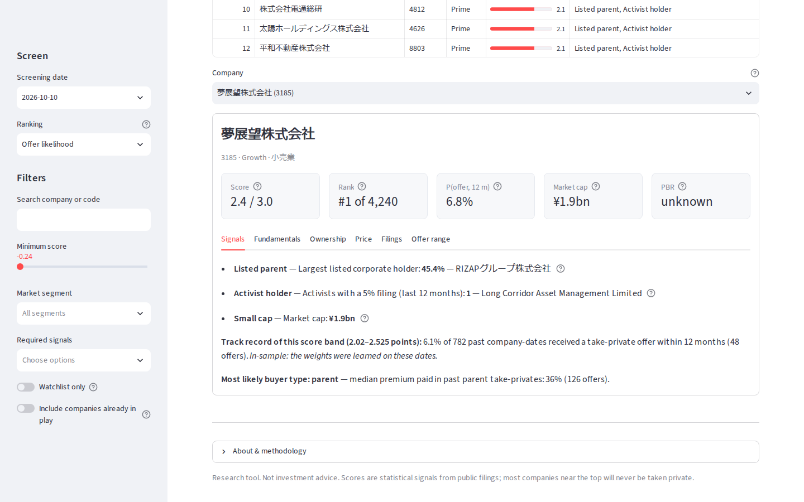
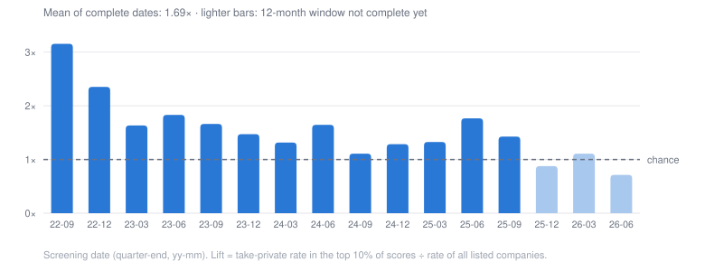
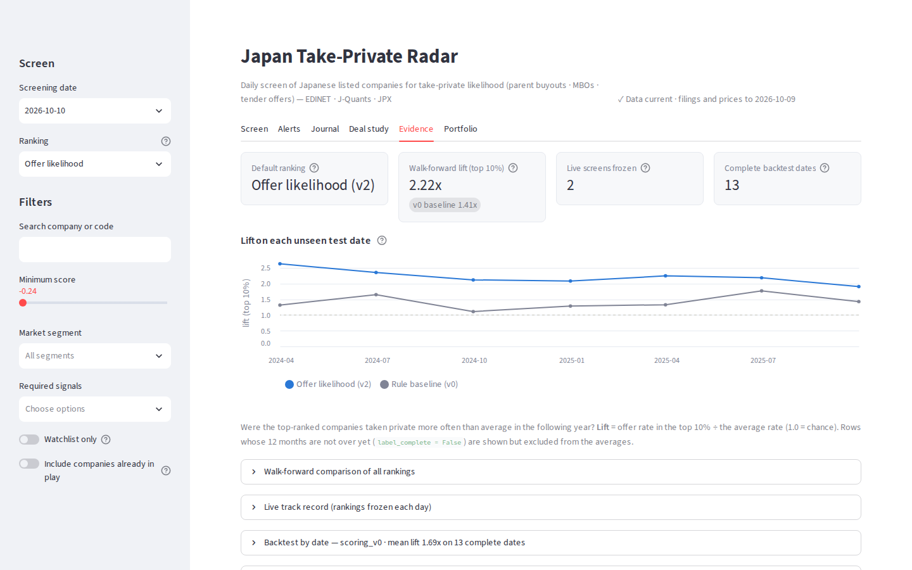
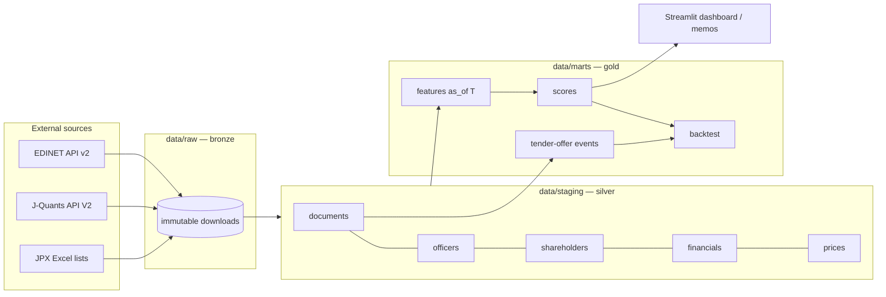

# Japan take-private radar

[](https://github.com/tavarel/Jptakeprivate/actions/workflows/ci.yml)

**Which Japanese listed companies are most likely to be taken private next — and why?**

Japan had a record 112 take-private tender offers and MBOs in 2025, driven by Tokyo Stock Exchange
pressure on capital efficiency, the unwinding of listed subsidiaries (親子上場) and ageing
founder-owners. This project screens ~4,200 listed companies every day from public filings,
explains each ranking with the facts behind it, and measures itself honestly against the deals
that actually happened.

> Research project. Not investment advice.



## What it does

1. **Ingests** every EDINET filing (annual reports, 5% reports, tender offers, 臨時報告書) and
   daily prices from J-Quants, JPX's official API.
2. **Parses** annual reports into tidy tables: officers with ages, top-10 shareholders by type,
   balance sheet, dividends, rental real estate at fair value.
3. **Builds point-in-time features** for any date: listed parent and its track record, family
   stake, activists, valuation, cash, liquidity, tradable shares, trends — using only what was
   public before that date.
4. **Ranks** companies two ways, because deals differ: *Offer likelihood* (rules with weights
   learned from 13 quarters; strongest on parent buyouts) and *MBO likelihood* (a per-type model).
5. **Alerts** on followed companies: new 5% holders and activists, tender offers, control changes
   in 臨時報告書 (new parent, major shareholder, squeeze-out), unusual trading, broken data.
6. **Explains** every company on one card — signals, fundamentals, ownership, filings and a
   likely offer price range from comparable past deals.
7. **Evaluates** every ranking walk-forward and keeps a live scoreboard of rankings frozen daily.



## Results (13 quarterly screenings, 2022-09 → 2025-09)

About **1.8%** of listed companies receive a take-private offer within a year.

| Ranking (top 10% of the list) | Lift vs chance | Parent buyouts | MBOs |
|---|---|---|---|
| **Offer likelihood** (learned weights, walk-forward on 7 unseen dates) | **2.2×** | **4.4×** | 0.3× |
| Hand-set rules (baseline) | 1.4× | 1.3× | 1.7× |
| Logistic models per deal type (MBO list) | 1.9× | 2.3× | **1.9×** |

Hand-set rules on every quarter-end (lift of the top 10%):



- **One signal carries most of it**: a listed company holding ≥ 20% (親子上場), then activists.
  The learned ranking beat the hand-set one on 7 of 7 unseen dates; the decision rule was written
  down before the test.
- **Who gets an offer ≠ what makes money.** The offer premium lands on a few names; a
  portfolio's return comes from the rest. As a portfolio, a simple value basket (small, below
  book, cash-rich) beat all listed companies on 6 of 7 dates; no ranking beat it by the
  pre-registered rule, and no strategy reaches 95% "chance of skill" after counting every try.
- **Seven overlapping test dates are weak evidence.** Every ranking is frozen daily and judged on
  the offers that come later — the only clean test.

Details, every candidate and every limitation: [docs/results.md](docs/results.md).



## Architecture



Layers only depend downwards: `ingest → parse → features → model → report`, orchestrated by
`pipeline.py` and exposed through a CLI. Details in [docs/architecture.md](docs/architecture.md).

## Quickstart

```bash
# requirements: Python 3.12+, uv (https://docs.astral.sh/uv/)
make setup                     # install deps + git hooks
cp .env.example .env           # add your free EDINET / J-Quants keys
make check                     # lint + type check + tests

uv run radar doclists --start 2025-06-01 --end 2025-06-30   # index one month of filings
uv run radar download --doc-type 120 --limit 5               # 5 annual reports (CSV)
uv run radar inspect-doc <docID> --grep "役員|Officer"        # explore a filing
uv run radar events                                          # tender-offer ground truth
```

## Daily use

After the one-time backfill, one command keeps everything
current and screens today:

```bash
uv run radar update            # new filings, prices and lists since the last run → today's scores
                               # + "what changed" since the previous screening (alerts note)
make app                       # dashboard: Screen · Alerts · Journal · Deal study · Evidence · Portfolio
uv run radar changes --from 2026-09-01 --to 2026-10-01   # compare any two screening dates
uv run radar audit --as-of 2026-10-01                    # recompute every score, check invariants
```

- `config/watchlist.yaml`: companies always followed (alerts + "watchlist only" filter).
- Followed companies' 臨時報告書 (new parent, major shareholder, representative, squeeze-out …)
  are fetched and alerted; companies new in the top 20 get a fact pack automatically.
- **Decision journal**: write each decision in `data/manual/journal.yaml` (see the Journal tab
  for the format); the tab shows the return since, any later offer and today's rank.
- The alerts note is saved as `data/marts/alerts_<date>.md` (ready to mail or paste in Slack).
- `radar update` only parses new reports; after changing a parser or `config/xbrl_elements.yaml`
  run a full `uv run radar parse`.
- **Retrain on the newest data** (each quarter-end becomes usable 12 months later): `make refit`
  reruns backtest → ablation → model → learned weights → walk-forward → weight stability (~2 h),
  then read `docs/results.md` before trusting the new numbers.

**Schedule it** — on WSL use the Windows Task Scheduler (WSL's own cron only runs while a WSL
terminal is open). Weekdays 07:30, also on battery, and run
at the next chance when the PC was off:

```bash
schtasks.exe /Create /TN "jp-takeprivate-radar daily update" /SC WEEKLY /D MON,TUE,WED,THU,FRI \
  /ST 07:30 /F /TR "C:\Windows\System32\wsl.exe -d Ubuntu -- bash -lc 'cd ~/jp-takeprivate-radar && ~/.local/bin/uv run radar update >> data/update.log 2>&1'"
powershell.exe -Command "Set-ScheduledTask -TaskName 'jp-takeprivate-radar daily update' -Settings (New-ScheduledTaskSettingsSet -AllowStartIfOnBatteries -DontStopIfGoingOnBatteries -StartWhenAvailable)"
```

Check it: `schtasks.exe /Query /TN "jp-takeprivate-radar daily update"` and `tail data/update.log`.
On plain Linux, a crontab line does the same:
`30 7 * * 1-5 cd ~/jp-takeprivate-radar && ~/.local/bin/uv run radar update >> data/update.log 2>&1`.

## Project status

Working end to end: EDINET backfill from 2021-09 (~23k filings, 21,848 annual reports parsed),
J-Quants prices from 2021-10, point-in-time features (ownership, family, valuation, trends,
sector, activists, momentum, dividends), learned rule weights and per-type models, walk-forward
evaluation with pre-registered decision rules, tender-offer premium study, alerts (5% filings,
tender offers, 臨時報告書, unusual trading), dashboard and a scheduled daily update — about 500
offline tests. What remains is time: the live scoreboard is the out-of-sample test.

## Method notes and known limitations

- **No look-ahead**: a filing counts only from the day after it was submitted; prices are lagged
  one day. Tests enforce this ([tests/test_features.py](tests/test_features.py)).
- **Family detection is a heuristic** (shared surname with the representative director, or family
  asset-management companies). It misses relatives with different surnames.
- **IFRS filers** use different XBRL elements: their balance-sheet items are left missing.
- **Event date = filing of the tender offer (240)**, not the announcement (TDnet, paid); a
  pre-announced offer can be public earlier.
- **The activist list is curated by hand**, with the year each fund's activism became public, to
  limit look-ahead. Homonymous company names are excluded only when checked by hand.
- **EDINET hides filings older than ~5 years**, so the backtest starts in 2022-09.
- **Rare-event evaluation**: accuracy is meaningless with a ~1.8% base rate; we report lift,
  precision@k and recall in the top decile, with Newey-West intervals and a deflated Sharpe ratio
  for portfolios.

## Tech

Python 3.12 · pandas · DuckDB · Parquet · httpx · pydantic · Typer · pytest · ruff · mypy (strict) ·
scikit-learn · Altair · Streamlit · GitHub Actions

## License

MIT
